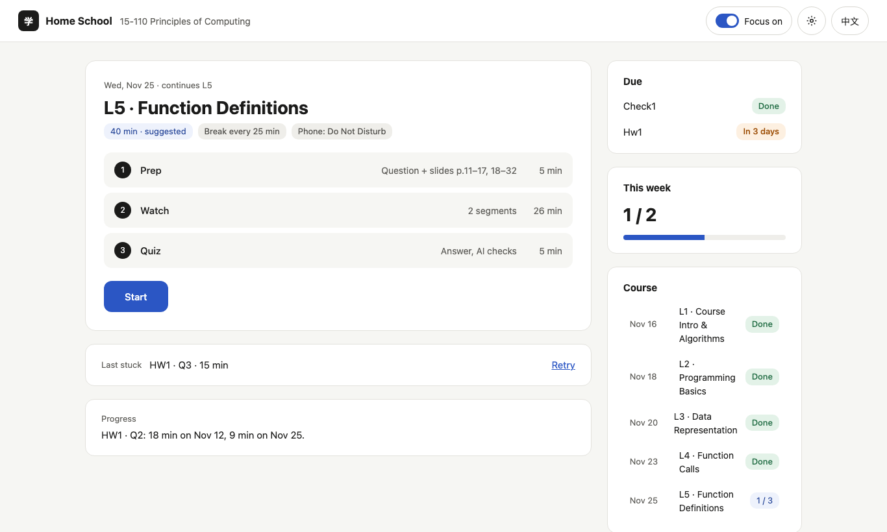
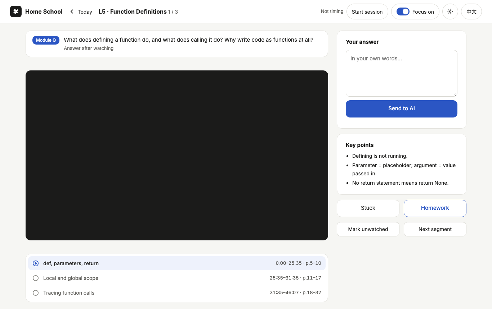
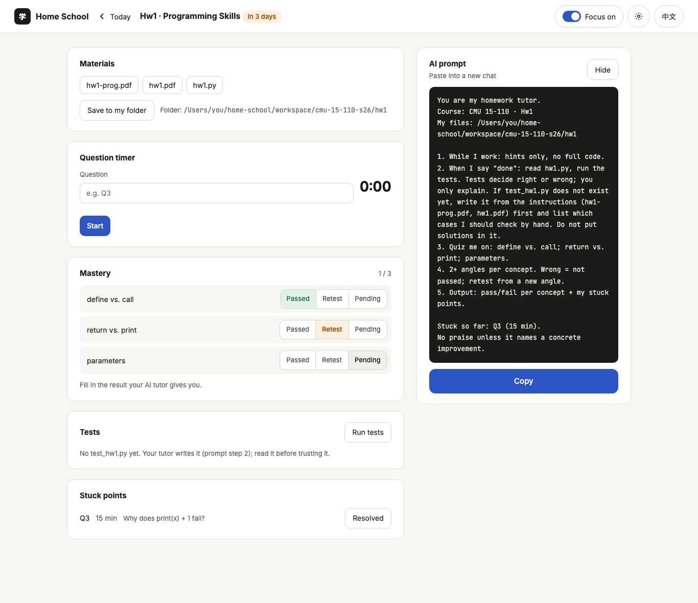

# Home School · 在家学

[中文说明](README.zh-CN.md)

A semi-supervised self-study app for people who want a real university course without paying for a degree.
It runs on your own computer. An AI "teacher" sets the pace, reminds you, checks what you
understood, and keeps a record of where you got stuck. You bring your own Claude or OpenAI key.



## The problem

Many university courses publish their lectures, slides and homework for free. What a solo learner
doesn't get is the structure around them: a pace and deadlines, questions that force active
watching, an honest check of understanding (the autograder isn't public), and someone who notices
when you're stuck. General chatbots don't fill the gap either: they write the homework for you or
praise half-right answers. Home School supplies that structure, strictly and locally.
Full problem statement: **[docs/PROBLEM.md](docs/PROBLEM.md)**.

The first course is **CMU 15-110 Principles of Computing (Spring 2026)**: public lectures on YouTube
([@CMULearn](https://www.youtube.com/@CMULearn)) and public [slides and homework](https://www.cs.cmu.edu/~15110-s26/).
Module 1 (L1–L5, Check1, Hw1) is filled in.

| Lesson | Assignment |
|---|---|
|  |  |

The video area is a YouTube embed that plays only the current segment (blank in this headless screenshot).
Chinese UI: [screenshot](docs/images/today-zh.png).

## Documentation

- [Problem statement](docs/PROBLEM.md): who it's for, what fails in self-study, goals, non-goals
- [Product design](docs/DESIGN.md): the study loop, every page, and the rules (breaks, stuck points, grading, encouragement)
- [Architecture](docs/ARCHITECTURE.md): code layout, data model, HTTP API, security, AI calls
- [Adding a course](docs/COURSE_FORMAT.md): `course.json` schema and the caption → segments workflow
- [Roadmap](docs/ROADMAP.md): known rough edges in 0.1, open questions, next steps
- [Contributing](CONTRIBUTING.md)

> Status: v0.1, an early prototype. The idea works end to end; many parts are deliberately simple.
> See the roadmap for what's rough.

## Quick start

Needs Python 3.9 or newer. No packages to install.

```sh
git clone https://github.com/andrew-wzj/home-school.git && cd home-school
python3 run.py            # opens http://127.0.0.1:8110/
```

Then open **Settings** (gear icon), pick Claude or OpenAI, and paste your API key.
Without a key everything still works; "Send to AI" gives you a prompt to paste into your own chat instead.

## How it works

**Today** answers one question: what should I do now? It shows one card with a suggested length,
break rhythm, and three steps (Prep → Watch → Quiz), plus upcoming due dates, this week's progress,
and your last stuck point with a Retry link.

**Lesson** plays only the current segment of the lecture (YouTube embed with `start`/`end`, nothing is
downloaded). The guiding question is shown before you watch; you answer after, and the AI grades it
strictly: `PASS` or `NOT YET`, what is missing, and a follow-up from a different angle. Key points
appear only after you have watched the segment. A timer runs during the session and calls a 5-minute
break every 25 minutes.

**Assignment** links the original materials, saves them to a local folder, and gives you a
collapsible tutor prompt to paste into a new chat with your own model. It also has:
- a per-question timer: after 15 minutes it suggests logging a stuck point and moving on;
- a Mastery list (Passed / Retest / Pending per concept) that you fill in from the tutor's verdict;
- a **Run tests** button. Tests decide right or wrong; the AI only explains. The original course's
  Gradescope autograder isn't available, so the tutor writes `test_hw1.py` from the instructions.
  Read it before you trust it.

**Focus** (top right) turns reminders off. Records are kept either way.
**Language**: English by default; the 中文 button switches the whole app and is remembered.
**Calendar**: Settings → Download .ics gives lecture days and due dates for Google Calendar (Settings → Import).

Encouragement is deliberately rare. Only the Today page shows it, and only when the data shows a
concrete improvement, e.g. "HW1 · Q4: 18 min on Nov 11, 9 min on Nov 25."

## Your data

| What | Where | In git? |
|---|---|---|
| API key | `config.local.json` (mode 600) | No (ignored) |
| Progress, answers, sessions, stuck points | `data/homeschool.db` (SQLite) | No |
| Caption backups | `data/transcripts/` | No |
| Homework files and tests | `workspace/<course>/<assignment>/` | No: the course forbids publishing solutions |

The server listens on `127.0.0.1` only and rejects requests from other sites.
Your key is sent only to the provider you choose.

## Adding a course

A course is one file: `courses/<id>/course.json`, with modules (each with a guiding question),
lectures, segments (YouTube ID, start/end seconds, slide pages, summary, concepts, prerequisites,
key points in English and Chinese) and assignments. See `courses/cmu-15-110-s26/course.json`.

To draft segments from captions:

```sh
# 1. Caption text only, never the video. Needs yt-dlp on PATH or at .bin/yt-dlp
python3 tools/fetch_captions.py VIDEO_ID
# 2. Your configured model finds where each topic starts and writes summaries (one API call)
python3 tools/digest.py VIDEO_ID "Python and the IDE (p.4-7)" "Data types (p.8-15)"
```

Paste the JSON into `course.json` and check the times against the video.
The 15-110 times were aligned this way by reading the transcripts.

## Development

```sh
python3 -m unittest discover -s tests -v
```

Layout: `homeschool/` (server, SQLite, planner, prompts, AI client), `web/` (plain HTML/CSS/JS, no
build step), `courses/`, `tools/`, `tests/`. The AI client uses plain HTTPS from the standard library,
so it runs on the Python that ships with macOS.

## Open questions (from the project brief)

These are placeholders in the code, each easy to swap out:
- **Pace**: 3 lectures/week (as the original course) or 2. Set in Settings.
- **Suggested length**: 30 min (unverified) until 3 sessions are recorded, then the median of the last 5,
  rounded to 5 and kept within 20–90 min (`homeschool/planner.py`).
- **"Needs encouragement" signals** (e.g. 3 fails in a row, repeated skipped plans): not implemented yet.
- **Chinese captions**: the player asks YouTube for `zh-Hans` captions when the UI is in Chinese.
  Whether auto-translate turns on reliably in an embedded player is unverified.
- **Calendar push to phone**: .ics export now; live Google Calendar sync later.
- **Side-panel tutor** that reads local files and runs tests directly: later.
- **API cost**: not estimated yet. Each "Send to AI" is one request.

## Limits

- A web page can't control your phone; it can only remind you.
- AI grading of written answers is subjective and can be lenient despite the prompt. Spot-check it.
- Videos can be deleted, made private, or blocked from embedding. When that happens the app shows a
  direct link instead, and the caption backup in `data/transcripts/` keeps the text.

## License

MIT. Course content (videos, slides, homework) belongs to Carnegie Mellon University and is linked, not copied.
