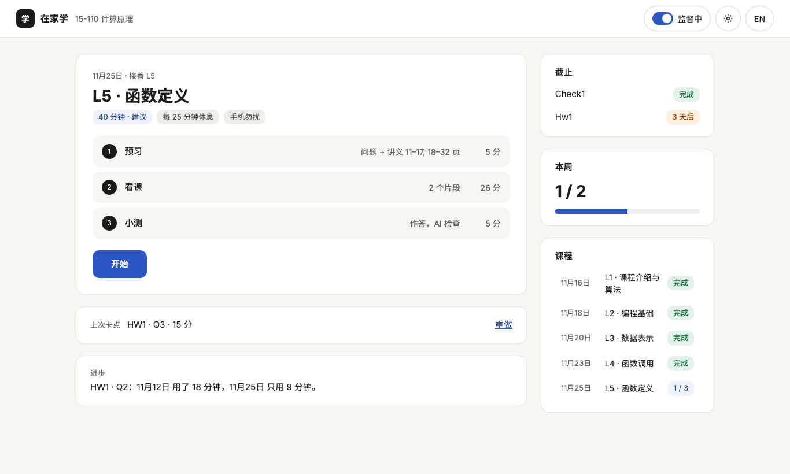

# 在家学 · Home School

[English](README.md)

给没钱读学位、但有自学动力的人用的“半监督”自学平台。在你自己的电脑上运行：AI 老师按进度布置任务、
设截止日期、提醒休息、严格考核你是否真懂，并记录你卡在哪里。用你自己的 Claude 或 OpenAI 密钥。



## 要解决的问题

很多大学课程的录像、讲义、作业都公开了，自学者拿得到**内容**，拿不到内容**外面那层结构**：

- **没有节奏**：原课程的截止日期属于已经结束的学期，“明天再看”一拖就是放弃。
- **被动看课**：一口气看完 45 分钟，感觉懂了，其实没留下什么；没人在看课前后问你问题。
- **卡住没人知道**：一道题耗掉一晚上，没有助教，也没有记录，以后也不会回头。
- **没有诚实的检验**：原课程的自动评分（Gradescope）用不了，很容易以为自己懂了。
- **通用 AI 太“好心”**：直接替你写作业，或者对半对的答案说“很棒”——两种都让学习消失。
- **在家学习时间没边界**：不休息，手机就在手边。

在家学针对每一条：按**你的**开始日期重排课表并给出截止日期；每讲切成 5–25 分钟的片段、只播当前片段，
看课前给引导问题、看完作答交 AI 严格评判（`通过` / `未过` + 换角度追问）；单题卡 15 分钟就记录卡点并跳过；
编程作业**对错由测试判定**，AI 只解释；每个概念至少从 2 个角度考，答错即重考；鼓励只在有具体进步时出现
（例：“Q4 两周前用了 18 分钟，今天 9 分钟”）；每 25 分钟提醒休息，开始前提醒手机勿扰。监督可随时关闭，记录照常保存。

完整的问题陈述（英文）：[docs/PROBLEM.md](docs/PROBLEM.md)。

第一门课是 **CMU 15-110 Principles of Computing（2026 春）**，已完成第一模块（L1–L5、Check1、Hw1），
视频 ID 和片段时间都是真实的（通过阅读字幕对齐）。

## 快速开始

需要 Python 3.9 或更高版本，不用装任何包。

```sh
git clone https://github.com/andrew-wzj/home-school.git && cd home-school
python3 run.py            # 打开 http://127.0.0.1:8110/
```

点右上角齿轮进入设置，选择 Claude 或 OpenAI 并填入密钥。不填密钥也能用：“发给 AI”会给你一段提示词，
贴到你自己模型的新对话里即可。右上角“中文”按钮切换全站语言，并会记住。

## 三个页面

- **今天**：只回答“今天该干嘛”——一张今日卡（建议时长、休息节奏、手机勿扰、预习 / 看课 / 小测三步）、
  截止列表（最近的橙色，其余灰色）、本周进度、上次卡点和重做入口。
- **上课**：引导问题 → 嵌入视频（只播当前片段）→ 片段列表；右侧作答并发给 AI、看完才显示的要点、卡点和作业按钮；顶部计时与休息倒计时。
- **作业**：资料链接和一键存到本地文件夹、单题计时、每个概念的过关状态、运行测试、卡点记录、可折叠可复制的 AI 辅导提示词。

## 数据与隐私

| 内容 | 位置 | 进 git 吗 |
|---|---|---|
| API 密钥 | `config.local.json`（权限 600） | 否 |
| 学习记录 | `data/homeschool.db`（SQLite） | 否 |
| 字幕备份 | `data/transcripts/` | 否 |
| 作业和测试 | `workspace/` | 否（课程政策禁止公开答案） |

服务只监听本机 `127.0.0.1`，并拒绝来自其他网站的请求。密钥只发给你选的服务商。

## 文档（英文）

- [问题陈述](docs/PROBLEM.md) · [产品设计](docs/DESIGN.md) · [技术架构](docs/ARCHITECTURE.md)
- [如何添加课程](docs/COURSE_FORMAT.md) · [路线图与已知不足](docs/ROADMAP.md) · [参与贡献](CONTRIBUTING.md)

> 状态：v0.1 早期原型。思路已经完整跑通，很多部分刻意做得很简单，详见路线图。

## 许可

MIT。课程内容（视频、讲义、作业）归卡内基梅隆大学所有，本项目只做链接，不复制。
